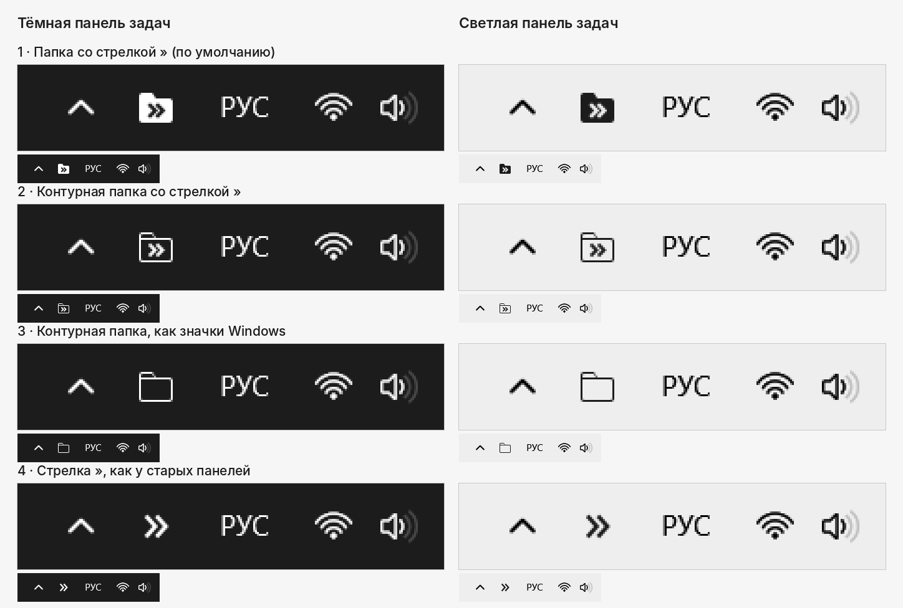

# TrayFolder

**Панели инструментов из Windows 10 — снова в Windows 11.** Значок папки в трее у часов: клик — и содержимое папки раскрывается меню с подпапками, как по стрелке » на старой панели задач.

Один файл исходника на C#, который собирается компилятором, уже встроенным в Windows. Без установки и зависимостей, готовый exe занимает около 40 КБ.

Код написан с помощью [Claude](https://claude.ai) — ИИ-ассистента компании Anthropic. Подробнее — в разделе [«Как сделан»](#как-сделан).

*English summary below.*

## Зачем

В Windows 10 любую папку можно было закрепить на панели задач как панель инструментов: стрелка » у часов разворачивала её содержимое списком, и нужный файл открывался в пару кликов без окна Проводника. В Windows 11 панель задач переписали, и эта функция исчезла. TrayFolder возвращает её обычной программой в трее — без патчей Проводника и сторонних оболочек.

## Возможности

- **Левый клик** по значку открывает меню с содержимым папки. Подпапки раскрываются при наведении, клик по файлу открывает файл, клик по папке открывает её в Проводнике. **Средний клик** открывает папку целиком.
- Имена, иконки, скрытые файлы и порядок сортировки — как в Проводнике.
- Несколько папок — несколько значков, как отдельные панели.
- Меню светлое или тёмное в тон панели задач. Значок рисуется кодом под точный размер трея и сам перекрашивается при смене темы, на выбор четыре варианта.
- Медленные сетевые и огромные папки читаются в фоне и не подвешивают программу. Если папка недоступна (вынули флешку, отключилась сеть), значок становится приглушённым.
- Автозапуск вместе с Windows и журнал ошибок.

## Установка

**Собрать самому** — рекомендуемый способ, ведь так вы видите весь код, который запускаете:

1. Скачайте архив репозитория (зелёная кнопка **Code → Download ZIP**) и распакуйте его в папку, где программа будет жить постоянно, например `C:\Tools\TrayFolder`.
2. Запустите `build.bat`. Он соберёт `TrayFolder.exe` компилятором C# из .NET Framework 4.x, который входит в Windows 10 и 11, так что ничего устанавливать не нужно. Если Windows спросит, запускать ли скачанный файл, разрешите.
3. Запустите `TrayFolder.exe` и выберите папку. Можно и просто перетащить папку на `TrayFolder.exe`.

**Готовый exe** лежит в разделе [Releases](../../releases). Его собирает сам GitHub из этого же кода (см. [`.github/workflows/build.yml`](.github/workflows/build.yml)), но цифровой подписи у файла нет. Поэтому при первом запуске Windows покажет предупреждение SmartScreen: нажмите «Подробнее», затем «Выполнить в любом случае».

> Windows 11 прячет новые значки трея под стрелку ^. Перетащите значок к часам или включите его в «Параметры → Персонализация → Панель задач».

## Как пользоваться

- **Правый клик** по значку: открыть папку в Проводнике, добавить ещё папку, выбрать вид значка, включить или выключить автозапуск, открыть журнал ошибок, закрыть.
- Добавленная папка сама попадает в автозапуск.
- `TrayFolder.exe` без параметров возвращает в трей все сохранённые папки, а `TrayFolder.exe "D:\Папка"` сразу добавляет указанную.

## Обновление

Положите новый `TrayFolder.cs` рядом с `TrayFolder.exe` и запустите `build.bat`. Он сам закроет программу, соберёт новую версию и снова запустит её со всеми вашими папками.

## Удаление

Для каждой папки: правый клик → снимите «Запускать вместе с Windows» → «Закрыть». Затем удалите папку с программой. Настройки хранятся в реестре в `HKCU\Software\TrayFolder`, журнал — в `%LOCALAPPDATA%\TrayFolder`, их тоже можно удалить.

## Как это устроено

WinForms и Win32: значок в трее — `NotifyIcon`, имена и иконки — `SHGetFileInfo`, запуск файлов — `ShellExecute`, как у Проводника. Программа работает с правами пользователя, пишет только в `HKCU` и не обращается к интернету. Значки рисуются с 16-кратным суперсэмплингом под точный размер трея (16, 20, 24 px и так далее), поэтому края остаются чёткими при любом масштабе.

## Ограничения

- В меню нет контекстного меню Проводника по правому клику и перетаскивания файлов.
- Это значок в трее, а не кнопка с подписью на панели задач.
- Интерфейс на русском языке.

## Как сделан

Весь код TrayFolder, значки и это описание написал [Claude](https://claude.ai) — ИИ-ассистент компании Anthropic. Идея, требования, выбор вариантов и проверка программы на Windows 11 — за автором проекта, mnd-kpr.

## Лицензия

[MIT](LICENSE): программу можно свободно использовать, менять и распространять. Она поставляется «как есть», без гарантий.

---

## English

**TrayFolder brings the Windows 10 taskbar folder toolbars back to Windows 11.** It places a folder icon next to the clock; clicking it opens the folder's contents as a cascading menu, just like the old » toolbar chevron.

- A single C# source file that builds with the C# compiler shipped with Windows: run `build.bat`, nothing to install. The exe is about 40 KB.
- Explorer-like names, icons, hidden-file settings and sorting; one icon per folder; light and dark menus that match the taskbar; four monochrome icon styles drawn in code.
- Slow network folders and huge folders load in the background; an unavailable folder gets a dimmed icon.
- Prebuilt, unsigned binaries are in [Releases](../../releases), built by GitHub Actions from this source.
- The user interface is in Russian.

**Made with Claude.** The code, the icons and this README were written by [Claude](https://claude.ai), Anthropic's AI assistant. The idea, requirements, design choices and testing on Windows 11 are by the project author, mnd-kpr.

Licensed under the [MIT License](LICENSE).
